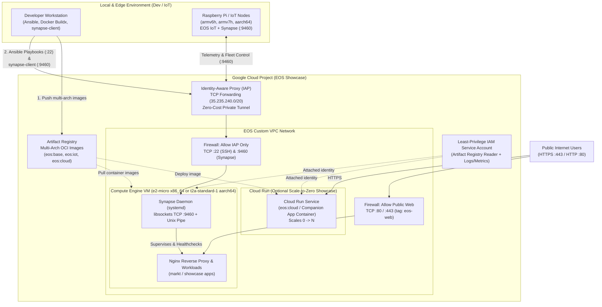

# Google Cloud solution architecture: EOS Cloud & IoT Fleet Showcase

## 1. Executive summary and workload overview

**EOS** is a modular GNU/Linux platform built on **Arch Linux** (`x86_64`) and **Arch Linux ARM** (`armv6h`, `armv7h`, `aarch64`), integrating the **[Synapse](https://github.com/williamlagos/synapse)** reactive process/sensor supervisor with **[libsockets](https://github.com/williamlagos/libsockets)** (`uv_sockets.h`) for asynchronous local Unix pipe (`/tmp/synapse.access`) and remote TCP (`:9460`) control.

This solution architecture defines a low-cost, zero-trust **Google Cloud & Terraform showcase** (`terraform/`) capable of:
1. Storing and distributing multi-architecture (`linux/amd64` and `linux/arm64`) EOS container images.
2. Running a stateful EOS Cloud VM (configurable between `x86_64` Free Tier `e2-micro` and `aarch64` `t2a-standard-1`) provisioned by the existing Ansible playbooks ([`playbooks/site.yml`](playbooks/site.yml)).
3. Acting as a central control hub for remote EOS IoT / Raspberry Pi nodes over Identity-Aware Proxy (IAP) TCP tunneling to Synapse (`:9460`).
4. Hosting companion personal/showcase projects (`markt`, `atria`, `contents`, `dinamo`, `pomodorino`) either on the consolidated VM or via an optional scale-to-zero Cloud Run service.

---

## 2. Requirements and current state

### 2.1. Functional requirements
* **Business processes**: Provide a unified, reproducible showcase platform for building, deploying, and supervising IoT edge nodes and personal Cloud workloads (`markt`, `atria`, `contents`, `dinamo`, `pomodorino`).
* **Activities and use cases**:
  * Build, store, and distribute multi-arch EOS container/VM images (`x86_64` and `arm64`).
  * Run stateful EOS VMs provisioned via [`playbooks/site.yml`](playbooks/site.yml).
  * Supervise processes and sensors via Synapse and query/manage nodes remotely over `libsockets` TCP (`:9460`).
  * Serve public HTTP/HTTPS web workloads (`:80`, `:443`).

### 2.2. Non-functional requirements
* **Security**: Restrict management ports—SSH (`:22`) and Synapse's TCP control plane (`:9460`)—strictly to private VPC / IAP TCP forwarding tunnels (`35.235.240.0/20`), exposing only HTTP/HTTPS (`:80/:443`) to the public internet. Enforce Shielded VM, OS Login, and least-privilege IAM service accounts.
* **Reliability**: Single-zone showcase deployment with automated process supervision via `synapse.service` (`Restart=on-failure`) and container healthchecks (`synapse-client ping`).
* **Cost**: Hobby / personal low-cost budget—defaulting to a single Free Tier eligible `e2-micro` VM (`x86_64`), optional Spot VM pricing, automated Artifact Registry cleanup policies, and scale-to-zero (`min_instance_count = 0`) for serverless Cloud Run containers.
* **Operations**: Fully declarative Infrastructure as Code (`terraform/`) paired with existing Ansible configuration management (`playbooks/`) and Docker Compose (`docker-compose.yml`).
* **Performance**: Native multi-architecture execution (`x86_64` and `aarch64`) with asynchronous, non-blocking `libuv` event loops in Synapse and `libsockets`.
* **Sustainability**: Scale-to-zero serverless containers and right-sized/shared-core VM instances (`e2-micro` / Ampere `t2a-standard-1`) to minimize idle compute energy consumption.

### 2.3. Current state
* **Current infrastructure**: Local multi-stage [`Dockerfile`](Dockerfile) (`base`, `iot`, `cloud`), [`docker-compose.yml`](docker-compose.yml), multi-machine [`Vagrantfile`](Vagrantfile), Arch Linux `PKGBUILD`s ([`packages/`](packages/README.md)), and Ansible playbooks ([`playbooks/`](playbooks/README.md)).
* **Pain points and drivers for migration/redesign**: Extend EOS from a purely local Docker/Vagrant/Raspberry Pi setup into a complete cloud-ready showcase with reproducible Terraform IaC.

### 2.4. Dependencies
* **Internal dependencies**: [`williamlagos/synapse`](https://github.com/williamlagos/synapse) (`synapse`, `synapse-client`, `libimpulse.so`), [`williamlagos/libsockets`](https://github.com/williamlagos/libsockets) (`libuv_sockets`), and companion applications (`markt`, `atria`, `contents`, `dinamo`, `pomodorino`).
* **External dependencies**: Arch Linux / Arch Linux ARM package repositories, `libuv`, Docker Buildx, Ansible, and Terraform (`hashicorp/google` provider).

---

## 3. Technical decomposition of the workload

1. **Multi-Arch Artifact & Image Registry Layer**: Stores `linux/amd64` and `linux/arm64` OCI container manifests (`eos:base`, `eos:iot`, `eos:cloud`) with automated retention and cleanup rules.
2. **Network & Perimeter Security Layer**: Dedicated VPC subnet with split firewall policies—public ingress only for web traffic (`:80`, `:443`) and identity-proxied private ingress for SSH (`:22`) and Synapse TCP control (`:9460`).
3. **Stateful VM & Fleet Hub Compute Layer**: Single configurable VM (`x86_64` or `aarch64`) running `synapse.service`, Nginx, Redis, and Docker workloads, provisioned via Ansible.
4. **Scale-to-Zero Serverless Container Layer**: Optional serverless container runtime for stateless companion APIs/frontends that scales to zero when idle.
5. **Identity & Least-Privilege Access Layer**: Custom workload service account restricted to pulling registry images and writing logs/metrics.

---

## 4. Proposed solution architecture

### 4.1. Google Cloud products and features mapping

| Component | Recommended Google Cloud product/feature | Justification and citations | Alternatives considered | Pros and cons of alternatives |
| :--- | :--- | :--- | :--- | :--- |
| **Multi-Arch Image Registry** | **[Artifact Registry](https://docs.cloud.google.com/artifact-registry/docs/overview)** | Native multi-arch OCI manifest support (`amd64`/`arm64`), 0.5 GB free tier, and built-in [cleanup policies](https://docs.cloud.google.com/artifact-registry/docs/repositories/cleanup-policy). | [Cloud Storage](https://docs.cloud.google.com/architecture/storage-advisor) | **Pros**: Cheap archive storage for raw rootfs tarballs.<br>**Cons**: Cannot serve standard `docker pull` OCI layers to Compute Engine or Cloud Run. |
| **Network & Control Perimeter** | **[VPC](https://docs.cloud.google.com/vpc/docs/overview)** + **[VPC Firewall Rules](https://docs.cloud.google.com/firewall/docs/firewalls)** + **[IAP TCP Forwarding](https://docs.cloud.google.com/iap/docs/using-tcp-forwarding)** | Secures `:22` (SSH) and `:9460` (Synapse) behind IAM-authenticated tunnels (`35.235.240.0/20`) at **$0** gateway cost ([SSH Network Access Best Practices](https://docs.cloud.google.com/compute/docs/connect/ssh-best-practices/network-access)). | [Cloud VPN](https://docs.cloud.google.com/network-connectivity/docs/vpn/concepts/best-practices) / Bastion VM | **Pros**: Site-to-site IPsec or dedicated jump host.<br>**Cons**: Incurs fixed hourly gateway/VM costs (~$36+/mo for VPN). |
| **Stateful VM & Fleet Hub** | **[Compute Engine](https://docs.cloud.google.com/compute/docs/instances)** (`e2-micro` `x86_64` / `t2a-standard-1` `aarch64`) | Supports stateful services, persistent disks, raw TCP (`:9460`), Ansible provisioning, and toggling between `x86_64` Free Tier and native `arm64` ([Application Hosting Options](https://cloud.google.com/hosting-options)). | [Google Kubernetes Engine (GKE)](https://docs.cloud.google.com/kubernetes-engine/docs/concepts/gke-and-cloud-run) | **Pros**: Multi-node orchestration and mixed arch pools.<br>**Cons**: Too heavy and costly for a personal single-node showcase. |
| **Scale-to-Zero Containers** | **[Cloud Run Services](https://docs.cloud.google.com/run/docs/fit-for-run)** | Runs stateless HTTP/WebSocket containers with `min_instance_count = 0`, costing $0 when idle ([Cloud Run Cost Optimization](https://docs.cloud.google.com/run/docs/tips/services-cost-optimization)). | [App Engine](https://docs.cloud.google.com/appengine/docs/the-appengine-environments) | **Pros**: Managed PaaS.<br>**Cons**: Standard doesn't run custom Arch Linux Dockerfiles; Flexible cannot scale to zero. |
| **Workload Identity** | **[Cloud IAM Service Accounts](https://docs.cloud.google.com/iam/docs/service-account-overview)** | Scopes VM and Cloud Run permissions to least-privilege roles ([Security Best Practices Catalog](https://docs.cloud.google.com/docs/security/security-best-practices-catalog/infrastructure)). | Default Compute Service Account | **Pros**: Zero setup.<br>**Cons**: Grants overly broad `roles/editor` project access by default. |

### 4.2. Architecture diagram



### 4.3. Architecture description
* **Data flow**: Public web users connect over HTTP/HTTPS (`:80`, `:443`) through the `eos-allow-public-web` firewall rule to Nginx on the EOS Cloud VM (or directly to the Cloud Run HTTPS URL) to access hosted applications (`markt`, `atria`, `contents`, `dinamo`, `pomodorino`).
* **Tasks/control flow**: Image builds are pushed from the developer workstation to Artifact Registry. Infrastructure is provisioned via Terraform (`terraform/`). Configuration management (`playbooks/site.yml`) and live process supervision queries (`synapse-client -h 127.0.0.1 -p 9460 status|list|reload`) traverse an IAM-authenticated IAP TCP tunnel (`35.235.240.0/20`) to `:22` and `:9460` on the VM.

---

## 5. Design and configuration recommendations

### 5.1. Security, privacy, and compliance
* **Access control**: Attach the custom `eos-node-sa` service account with only `roles/artifactregistry.reader`, `roles/logging.logWriter`, and `roles/monitoring.metricWriter`, and enforce OS Login (`enable-oslogin = "TRUE"`) on the VM.
* **Data protection**: Enable Shielded VM (`enable_secure_boot`, `enable_vtpm`, `enable_integrity_monitoring`) to verify boot integrity.
* **Network Security**: Isolate `:22` and `:9460` behind `35.235.240.0/20` (IAP TCP Forwarding) and internal VPC range `10.42.0.0/24`; restrict `:80/:443` via the `eos-web` network tag.

### 5.2. Reliability
* **Process supervision**: Use `synapse.service` (`Restart=on-failure`) and `libimpulse.so` state checks to automatically monitor and restart local services (`nginx`, `redis`).

### 5.3. Operational excellence
* **Monitoring and logging**: Forward `synapse` logs (`-l -` stdout/stderr) to systemd journald and Cloud Logging.
* **Infrastructure as Code (IaC)**: Use `terraform output` helper commands (`iap_ssh_tunnel_command`, `iap_synapse_tunnel_command`) to hand off seamlessly to Ansible ([`playbooks/site.yml`](playbooks/site.yml)) and `synapse-client`.

### 5.4. Cost optimization
* **Sizing and scaling**: Default to `e2-micro` (`x86_64`) in `us-central1` with `STANDARD` network tier and `pd-standard` disk; keep `enable_cloud_run = false` (or `min_instance_count = 0`) and Artifact Registry cleanup policies active.
* **Pricing models**: Enable `spot_instance = true` when testing non-free-tier machine types such as `t2a-standard-1` (`arm64`).

### 5.5. Performance efficiency
* **Event-driven supervision**: Leverage `libuv` and `libsockets` (`uv_sockets.h`) for non-blocking asynchronous I/O with minimal memory overhead on small `e2-micro` or Raspberry Pi instances.

### 5.6. Sustainability
* **Idle resource elimination**: Scale stateless containers to zero on Cloud Run and consolidate stateful hobby services onto a single right-sized VM.

---

## 6. Deployment guidance

### 6.1. Deployment prerequisites
* Terraform `>= 1.5.0`
* Google Cloud SDK (`gcloud`) authenticated (`gcloud auth application-default login`)
* Ansible (`ansible-playbook`) for post-VM OS configuration

### 6.2. Step-by-step deployment instructions
1. **Configure variables**:
   ```sh
   cd terraform
   cp terraform.tfvars.example terraform.tfvars
   # Edit terraform.tfvars with your project_id
   ```
2. **Initialize and validate Terraform**:
   ```sh
   terraform init
   terraform validate
   terraform plan
   ```
3. **Provision infrastructure (when ready to deploy)**:
   ```sh
   terraform apply
   ```
4. **Tunnel SSH & Synapse via IAP**:
   ```sh
   # Open SSH tunnel on port 2224 for Ansible
   $(terraform output -raw iap_ssh_tunnel_command)

   # Open Synapse TCP tunnel on port 9460
   $(terraform output -raw iap_synapse_tunnel_command)
   synapse-client -h 127.0.0.1 -p 9460 status
   ```

---

## 7. Validation plan

* **Offline / Dry-Run Validation (No Cloud Resources Created)**:
  ```sh
  cd terraform
  terraform init -backend=false
  terraform fmt -check
  terraform validate
  ```
* **Static Policy Verification**:
  * Verify `eos-allow-iap-control` only permits `35.235.240.0/20` and `10.42.0.0/24` on ports `22` and `9460`.
  * Verify `eos-allow-public-web` only permits ports `80` and `443` on tag `eos-web`.
  * Verify `eos-node-sa` only binds least-privilege reader/logging/monitoring roles.

---

## 8. References
* [Artifact Registry Overview](https://docs.cloud.google.com/artifact-registry/docs/overview)
* [Artifact Registry Cleanup Policies](https://docs.cloud.google.com/artifact-registry/docs/repositories/cleanup-policy)
* [SSH Network Access Best Practices & IAP TCP Forwarding](https://docs.cloud.google.com/compute/docs/connect/ssh-best-practices/network-access)
* [Identity-Aware Proxy TCP Forwarding](https://docs.cloud.google.com/iap/docs/using-tcp-forwarding)
* [Cloud Run Fit Assessment](https://docs.cloud.google.com/run/docs/fit-for-run)
* [Cloud Run Services Cost Optimization](https://docs.cloud.google.com/run/docs/tips/services-cost-optimization)
* [Google Cloud Well-Architected Framework: Cost Optimization](https://docs.cloud.google.com/architecture/framework/cost-optimization/optimize-resource-usage)
* [Google Cloud Well-Architected Framework: Security by Design](https://docs.cloud.google.com/architecture/framework/security/implement-security-by-design)
* [Google Cloud Well-Architected Framework: Automate and Manage Change](https://docs.cloud.google.com/architecture/framework/operational-excellence/automate-and-manage-change)
